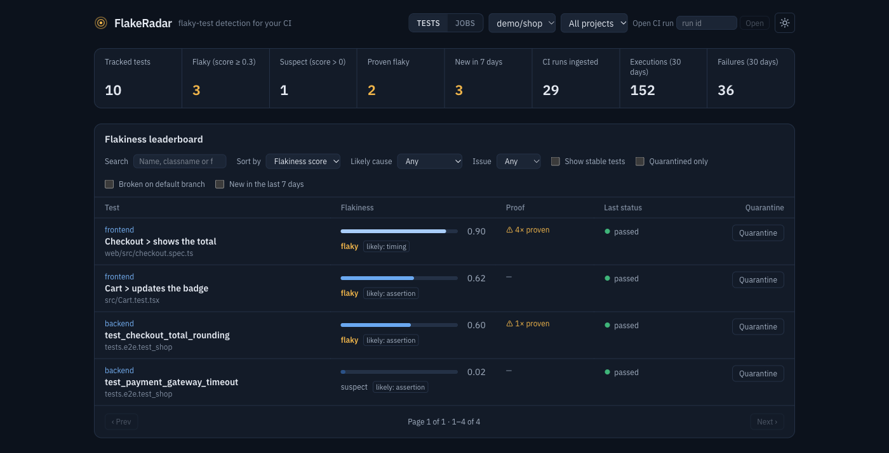
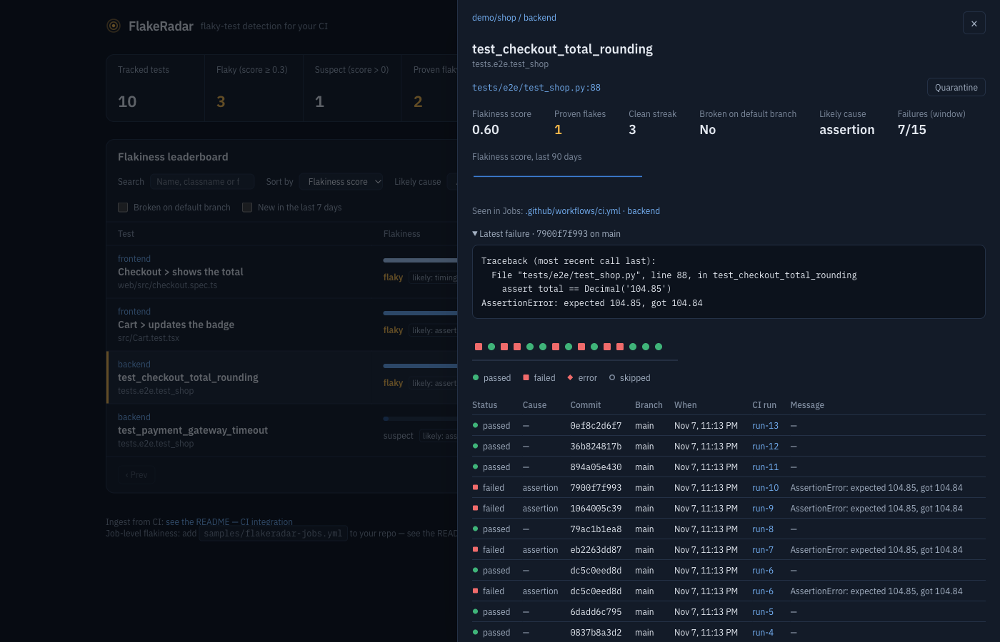
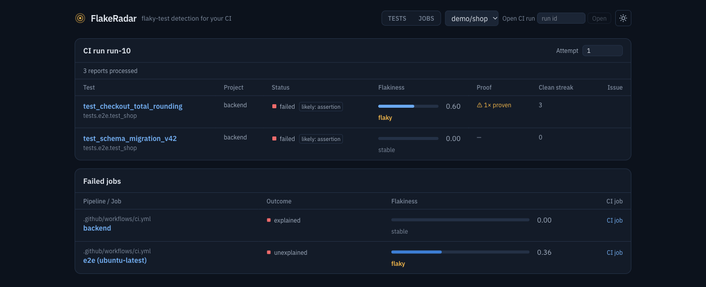

# FlakeRadar


FlakeRadar is a self-hosted service that finds flaky tests and flaky CI jobs.
It is an open-source alternative to BuildPulse and Datadog CI Visibility for
small engineering teams.

When a developer re-runs a failed CI job and it passes, the evidence of a flaky
test is usually lost. FlakeRadar keeps that evidence. It reads JUnit XML
reports from any CI system and any test runner that writes JUnit XML, for
example pytest, Jest, Vitest, Go and JUnit. It records the outcome of each test
in each run, with the commit SHA, and calculates a flakiness score for each
test. When a test passes and fails on the same commit, that is proof that the
test is nondeterministic.



FlakeRadar began as a fork of Joseph Maniate's
[manijose1919/flakeradar](https://github.com/manijose1919/flakeradar), and the
idea and the first version are his. This project has since been rewritten in
Rust with a different data model, ingest pipeline and API, and it no longer
shares a roadmap or compatibility with that project. The two are independent.
It stays under the Apache License 2.0, and the original copyright notice is
kept in [NOTICE](NOTICE).

## Who it is for

FlakeRadar is for teams of approximately 2 to 50 developers who:

- run tests in CI (GitHub Actions, GitLab CI, Jenkins, or any CI that can write
  JUnit XML) and no longer trust a red build.
- re-run failed jobs by habit, without knowing which tests are unreliable.
- cannot justify the cost of a paid CI analytics platform, and do not want a
  real regression to hide behind a test that "is always flaky".

A solo developer with a 30-second test suite does not need FlakeRadar.

## What it does

- One CI step uploads the results. The server stores each report and answers
  `202` before it processes the report.
- The score separates flaky tests from broken tests. A test that fails each
  time scores 0. A test that changes between pass and fail scores high. A pass
  and a fail on the same commit set the score to 0.6 or higher.
- One instance keeps data for many repos. Each repo can have more than one
  test suite (project), for example `frontend`, `backend` and `e2e`.
- Each flaky test shows its file and line, a GitHub permalink at the last
  failing commit, and the full traceback of each failure.
- Fixed rules give each failure a likely cause: network, environment, timing,
  assertion or other.
- A daily score history shows if a test becomes worse or better, and a clean
  streak shows if a fix continues to work.
- FlakeRadar also scores CI jobs. A job failure that a failing test explains
  does not count against the job.
- A quarantine list tells your test runner which tests to skip.
- An MCP server gives AI agents the worst flaky tests, with the data to fix
  them.
- Optional GitHub issues and Slack or webhook notifications tell you when a
  test or job becomes flaky. You can also link issues that other tools or
  people filed.
- The dashboard has a repo and project picker, a paginated leaderboard of
  flaky and suspect tests and jobs, and a detail panel. Each view has a URL
  that you can share.

[How FlakeRadar works](docs/concepts.md) explains the scoring rules.

| Test detail | CI run failures |
|---|---|
|  |  |

## Quick start

FlakeRadar is one binary plus a PostgreSQL database. Docker Compose runs both.
In a clone of this repository:

```bash
cp .env.example .env
# Set FLAKERADAR_API_TOKEN in .env. To make a token: openssl rand -base64 32
docker compose up --build
```

Open `http://localhost:8000`. The dashboard, the API and the MCP server are on
this address.

To load demo data, run the sample script. It needs Python and the `httpx`
package:

```bash
python samples/simulate_ci.py http://localhost:8000 "<your FLAKERADAR_API_TOKEN>"
```

Then open `http://localhost:8000/?repo=demo/shop`.

To run the release binary without Docker, or to build from source, see
[Deploy FlakeRadar](docs/deployment.md).

## CI integration

On GitHub Actions, add the report action after your tests:

```yaml
- name: Report test results to FlakeRadar
  if: always()   # always report: the failed runs are the evidence
  uses: andrewthetechie/flakeradar/actions/report@<ref>
  with:
    url: ${{ secrets.FLAKERADAR_URL }}
    token: ${{ secrets.FLAKERADAR_TOKEN }}
    project: backend
    files: junit.xml
```

Any other CI system sends the same report with `curl`. [CI integration](docs/ci-integration.md)
has the full guide:

- the inputs of the report action.
- the `curl` call for other CI systems.
- runner settings for test file locations and retries.
- job reports, to find flaky CI jobs.
- the failures of one CI run, and the summary action.

## Documentation

| Guide | Contents |
|---|---|
| [Deploy FlakeRadar](docs/deployment.md) | Docker Compose, the release binary, building from source, replicas, upgrading from 0.1.x. |
| [Configuration](docs/configuration.md) | Each `FLAKERADAR_` setting and its default, and logging. |
| [Monitoring](docs/monitoring.md) | Health checks and Prometheus metrics. |
| [CI integration](docs/ci-integration.md) | Sending test and job results, and reading the failures of a CI run. |
| [How FlakeRadar works](docs/concepts.md) | Repos and projects, scoring, broken tests, trends, failure categories, quarantine. |
| [GitHub issues](docs/github-issues.md) | Automatic issue filing, the filing gate, and linking issues filed elsewhere. |
| [Notifications](docs/notifications.md) | Slack and webhook messages when a test or job becomes flaky or recovers. |
| [MCP server for agents](docs/mcp.md) | Connecting an AI agent, and the tools it can use. |
| [API reference](docs/api.md) | Each HTTP endpoint. |

## Upgrading from 0.1.x

FlakeRadar 0.1.x was a Python server. 0.2 is a fresh install with no data
migration, and it does not start on a database that 0.1.x created. Read
[Upgrading from 0.1.x](docs/deployment.md#upgrading-from-01x) for more info.

## Development

```bash
cargo nextest run --all-features --profile ci   # needs Docker, or FLAKERADAR_TEST_DATABASE_URL
cd frontend && npm test                         # Vitest
cd frontend && npm run build                    # strict TypeScript check
```

[CONTRIBUTING.md](CONTRIBUTING.md) has the full gate, the migration recipe and
the crate layout.
