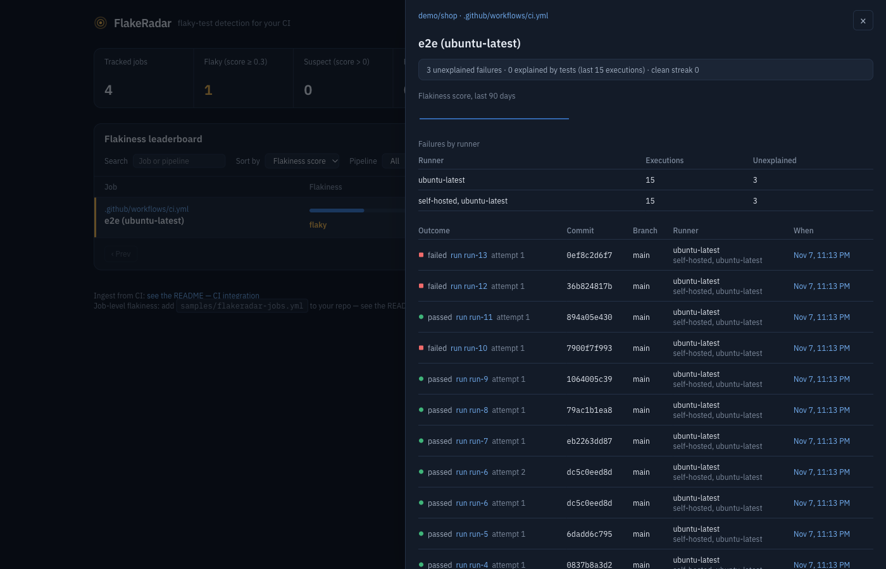
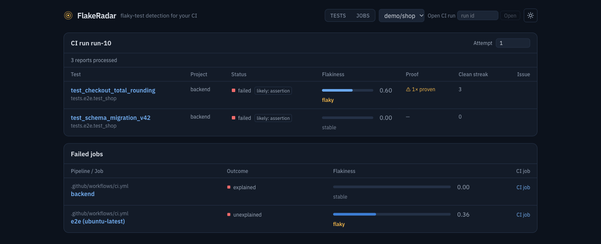

# CI integration

FlakeRadar needs two kinds of data from your CI:

- [Test results](#send-test-results): one JUnit XML report after each test run,
  including failed runs. The failed runs are the evidence.
- [Job results](#send-job-results) (optional): the outcome of each job in a CI
  run, so that FlakeRadar can find flaky CI jobs.

Then a CI gate or a bot can ask [which failures of one CI run are known
flaky](#failures-of-one-ci-run).

## Send test results

### The report action (GitHub Actions)

On GitHub Actions, add the report action as a step after your tests. It
uploads each JUnit XML file that it matches as its own report. It reads the
run metadata from the runner. Thus a copy in your repo cannot become out of
date when the ingest API gets a new parameter.

```yaml
- name: Report test results to FlakeRadar
  if: always()   # always report: the failed runs are the evidence
  uses: andrewthetechie/flakeradar/actions/report@<ref>
  with:
    url: ${{ secrets.FLAKERADAR_URL }}      # required
    token: ${{ secrets.FLAKERADAR_TOKEN }}  # required
    project: backend
    root: backend
    files: |            # globs, one per line; each match is its own Report
      junit.xml
      target/surefire-reports/TEST-*.xml
    # line_base: 0      # uncomment for pytest's junit_family=xunit1 (0-based line numbers)
```

| Input | Required | Meaning |
|---|---|---|
| `url` | yes | Your FlakeRadar base URL, for example `https://flakeradar.example.com`. |
| `token` | yes | Your FlakeRadar API token (`FLAKERADAR_API_TOKEN`). The action sends it as `X-API-Key` with each upload. |
| `project` | no (`default`) | The test suite in the repo, for example `frontend`, `backend` or `e2e`. Use one step for each project. See [One project per variant](#one-project-per-variant) when a matrix leg should get its own project. |
| `root` | no | The directory of the project in the repo, for example `backend`. FlakeRadar uses it to make file paths and permalinks. |
| `files` | no (`junit.xml`) | Globs of the JUnit XML files to upload, relative to the workspace, one on each line. The action uploads each match as its own report, so one step covers the one-file-for-each-class output of Surefire or Gradle. When nothing matches, the step writes a warning and does not fail. |
| `line_base` | no (`1`) | `0` when the runner writes 0-based line numbers (pytest's `junit_family=xunit1`). FlakeRadar stores 1-based lines, so permalinks point at the test. |
| `fail-on-error` | no (`false`) | `true` fails the step when the server does not accept a file after the upload retries. By default, reporting does not fail the build. |

The action calculates `repo`, `commit_sha`, `branch`, `ci_run_id`,
`ci_run_attempt`, `ci_job_id` (`job.check_run_id`), `pipeline` and
`default_branch` from the runner environment. It uploads each matched file with
the same retry flags as the [raw call](#other-ci-systems). It writes the ids of
the accepted reports to its `report_ids` output, in upload order. It needs only
bash, `curl` and `jq`, which are on GitHub-hosted runners.
[`samples/github-actions-snippet.yml`](../samples/github-actions-snippet.yml)
has the same step, with comments.

After the report action, add the [summary action](#the-summary-action-github-actions)
to show which failures of the job are known flaky.

### One project per variant

A Test belongs to one Project, so the same Test on two matrix legs is one Test
with one Flakiness score: its clean runs on Linux average away its flakes on
Windows. When a Test is flaky on only one OS, runtime or matrix leg, give each
variant its own Project, such as `backend-linux` and `backend-windows`, and
keep the same `root` (`backend`), because both Projects are the same directory.
Report each leg under its own Project:

```yaml
strategy:
  matrix:
    variant: [linux, windows]
# ...
- name: Report test results to FlakeRadar
  if: always()   # always report: the failed runs are the evidence
  uses: andrewthetechie/flakeradar/actions/report@<ref>
  with:
    url: ${{ secrets.FLAKERADAR_URL }}      # required
    token: ${{ secrets.FLAKERADAR_TOKEN }}  # required
    project: backend-${{ matrix.variant }}
    root: backend
```

Each variant then has its own score, history, quarantine and GitHub issue. That
is the cost as well as the gain: the same Test appears once per Project, and a
quarantine applies to one Project's Test (it is stored under `repo` and
`project`), as does the issue link, so a Test that is flaky on both variants
gets two issues. Each variant's score also needs its own history of runs before
it means anything. A Test that is flaky everywhere is better left in one
Project, where the evidence of all the variants adds up.

A Project name is 1-100 characters of `a-z`, `0-9`, `.`, `_` or `-`, so a matrix
value with a space or an upper-case letter must be mapped to a valid name.
FlakeRadar does the case part of that mapping: it trims and lower-cases every
name before it checks it, so `project: backend-${{ matrix.variant }}` works when
the variant is `Linux` or `Windows`. It does not work when the variant is
`Windows Server 2022`, because a Project name holds no space: keep a second
matrix key with the name you want, and report
`project: backend-${{ matrix.project }}`.

### Other CI systems

On other CI systems, or when you want the raw call, send the report with
`curl` and the same values as query parameters. The step below uses GitHub
Actions syntax. On another system, get the values of `repo`, `commit_sha`,
`branch` and the other parameters from the variables of that system.

```yaml
- name: Report to FlakeRadar
  if: always()   # always report: the failed runs are the evidence
  run: |
    PIPELINE="${GITHUB_WORKFLOW_REF#${GITHUB_REPOSITORY}/}"; PIPELINE="${PIPELINE%@*}"
    QUERY=$(jq -rn --arg repo "${{ github.repository }}" --arg project "backend" \
      --arg root "backend" --arg sha "${{ github.sha }}" --arg branch "${{ github.ref_name }}" \
      --arg run "${{ github.run_id }}" --arg attempt "${{ github.run_attempt }}" \
      --arg job "${{ job.check_run_id }}" --arg pipeline "$PIPELINE" \
      --arg default_branch "${{ github.event.repository.default_branch }}" \
      '"repo="+($repo|@uri)+"&project="+($project|@uri)+"&root="+($root|@uri)+"&commit_sha="+($sha|@uri)+"&branch="+($branch|@uri)+"&ci_run_id="+($run|@uri)+"&ci_run_attempt="+($attempt|@uri)+"&ci_job_id="+($job|@uri)+"&pipeline="+($pipeline|@uri)+"&default_branch="+($default_branch|@uri)')
    curl --fail-with-body -sS --retry 5 --retry-all-errors --retry-delay 2 \
      -X POST "${{ secrets.FLAKERADAR_URL }}/api/ingest?${QUERY}" \
      -H "X-API-Key: ${{ secrets.FLAKERADAR_TOKEN }}" \
      -H "Content-Type: application/xml" \
      --data-binary @junit.xml
```

| Parameter | Required | Meaning |
|---|---|---|
| `repo` | yes | `owner/name`, converted to lowercase. On GitHub Actions, use `${{ github.repository }}`. |
| `project` | no (`default`) | The test suite in the repo, for example `frontend`, `backend` or `e2e`. |
| `root` | no | The directory of the project in the repo, for example `frontend`. FlakeRadar uses it to make file paths and permalinks. |
| `commit_sha` | yes | The commit that the tests ran on. |
| `branch` | no (`main`) | The branch that the tests ran on. |
| `ci_run_id` | no | The workflow run ID (`${{ github.run_id }}`). |
| `ci_run_attempt` | no | The run attempt number (`${{ github.run_attempt }}`). A re-run is a new attempt on the same SHA. |
| `ci_job_id` | no | The ID of this job (`${{ job.check_run_id }}`). It links the run to a job execution, so that failing tests can explain a failed job. |
| `pipeline` | no | The workflow file path, for example `.github/workflows/ci.yml`. The snippet gets it from `GITHUB_WORKFLOW_REF`. |
| `default_branch` | no | The default branch of the repo. Flips on other branches do not count. |
| `line_base` | no (`1`) | `0` when the runner writes 0-based line numbers (pytest's `junit_family=xunit1`). FlakeRadar stores 1-based lines, so permalinks point at the test. |

When the server has stored the report, it answers
`202 {"report_id": 7, "status": "pending"}`. `GET /api/reports/7` shows when
processing is complete. The `--retry` flags help when the server is not
available for a short time, for example during a redeploy.

### Retried uploads

A retry can also occur after the server stored the report but the response was
lost. An upload is a duplicate when its body bytes, project, commit,
`ci_run_id`, `ci_run_attempt`, `ci_job_id` and `line_base` are the same as an
earlier upload. Ingest then returns the id and current status of the first
report, with `"duplicate": true`. Nothing new goes into the queue, so the retry does not
make a second run.

An upload with a different `line_base` is not a retry. It is a corrected
report, and FlakeRadar processes it like any other report.

The duplicate check is best effort:

- There is no unique constraint, so two identical uploads at the same time can
  both be stored.
- After `REPORT_RETENTION_DAYS` deletes the processed report, FlakeRadar
  ingests a later retry again. This is acceptable because a client retries
  within seconds.

### Test locations

When a JUnit report gives the file and line of a test, FlakeRadar stores them.
It links to the code on GitHub at the last failing commit. Most runners need a
setting to write the file and line:

| Runner | Setting |
|---|---|
| pytest | `pytest --junitxml=junit.xml -o junit_family=xunit1`. Its line numbers start at 0, so pytest uploads add `line_base=0`. FlakeRadar then stores 1-based lines. |
| Vitest | `reporters: [["junit", { addFileAttribute: true }]]` |
| Jest (jest-junit) | `JEST_JUNIT_ADD_FILE_ATTRIBUTE=true` |

Runners that do not write a file attribute, such as Go and cargo-nextest, also
work. FlakeRadar identifies the test by its classname and name. It keeps the
full traceback of each failure, and the traceback usually contains `file:line`.

### Test retries

When a runner retries a test in one run, FlakeRadar stores each attempt. A test
that fails and then passes on retry has a fail and a pass on the same commit.
Thus it is a proven flake from its first run.

| Runner | Setting |
|---|---|
| Playwright 1.59 or later | `reporter: [["junit", { outputFile: "junit.xml", includeRetries: true }]]`, or `PLAYWRIGHT_JUNIT_INCLUDE_RETRIES=1` |
| Maven Surefire / Failsafe | `-Dsurefire.rerunFailingTestsCount=2`. Surefire writes retries as `<flakyFailure>` or `<rerunFailure>`. |
| cargo-nextest | `retries = 2` in a profile in `.config/nextest.toml`, with `[profile.<name>.junit] path = "junit.xml"`. nextest writes retries as `<flakyFailure>`. |

Runners that write each attempt as a separate `<testcase>` with the same name
also work. Without these settings, a retried test that passes at the end looks
like a clean pass.

With `flaky-result = "fail"`, nextest fails a test that passed only on retry.
It writes the passing try as a `<failure>` with the message
`test passed on attempt N/M but is configured to fail when flaky`. FlakeRadar
stores that try as a pass. Thus the test is still a proven flake, and
`/api/ci-runs/{ci_run_id}/failures` shows it with `status: "passed"`. The job
still fails, and the failed tries explain it.

Each failed retry counts as one failure. This includes the count for
`FLAKERADAR_GITHUB_ISSUE_MIN_FAILURES`. With 2 retries, one run can add 3
failures.

## Send job results

FlakeRadar also scores CI jobs for flakiness, with the same rules as tests. A
job does not need to write JUnit XML.



### Set up job reports on GitHub

1. Copy [`samples/flakeradar-jobs.yml`](../samples/flakeradar-jobs.yml) to
   `.github/workflows/flakeradar-jobs.yml` on your default branch. The
   `workflow_run` trigger works only from the default branch.
2. In that file, list the workflows to track by their exact `name:`. Globs do
   not work.
3. Add the `FLAKERADAR_URL` and `FLAKERADAR_TOKEN` secrets. The workflow needs
   the `actions: read` permission.

After each attempt of a listed workflow, this workflow gets the job results of
that attempt and sends them to `POST /api/ingest/pipeline`. FlakeRadar never
calls GitHub for job results. Your workflow sends the results to FlakeRadar.

Each job execution needs a branch. Thus the workflow skips an attempt that has
no branch, for example a run that a tag push started, and writes a notice.

The report action and the raw `curl` call send `ci_job_id`, `ci_run_attempt`
and `pipeline`. These values link each test run to the job execution that made
it.

### Terms

- A pipeline is a named CI workflow in a repo. On GitHub, its workflow file
  path identifies it, for example `.github/workflows/ci.yml`. A pipeline
  contains jobs. FlakeRadar does not score pipelines.
- A job is one job in a pipeline. Its display name identifies it. Each matrix
  leg is a separate job, for example `test (ubuntu-latest, 3.12)`. A job
  belongs to a repo through its pipeline. It does not belong to a project.
- A job execution is the outcome of one job (`passed`, `failed` or `skipped`)
  in one attempt on one commit. When a job fails and a re-run on the same SHA
  passes, the job is a proven flake. This rule is the same as for tests.

### Explained and unexplained job failures

A failed test often causes a failed job. If FlakeRadar also counted that
failure against the job, it would count one flaky test two times. Thus a
failed job execution is explained when a JUnit report with the same
`ci_job_id` and repo contains a failed or errored test.
FlakeRadar scores an explained failure as `skipped`.

Only unexplained failures change the score of a job. Examples are setup
failures, network failures, runner failures, and crashes before the tests
start.

For this to work, each JUnit report must send `ci_job_id`. Without it, all
failures of that job are unexplained. The job can then look flaky when a test
caused the failure.

### Failures by runner

One bad runner often causes many unexplained failures. Thus FlakeRadar groups
the failures of a job by runner, over the recent scoring window of the job:

- by the sorted label set.
- by runner name, when a name repeats. GitHub-hosted runner names are unique
  for each run, so a name group identifies a self-hosted machine.

FlakeRadar sorts the groups by unexplained-failure rate. The top groups show in
these places, so you can see a cluster on one runner:

- the "Failures by runner" table in the job detail panel.
- the job history API.
- `runners` in the MCP tool `get_job`.
- the body of the issue that FlakeRadar files.

### Summary jobs (alls-green)

A summary job such as
[`alls-green`](https://github.com/marketplace/actions/alls-green#why) runs no
tests. It only reports if the jobs in its `needs` list succeeded. Thus it fails
when any of them fails, and that failure tells nothing about the summary job
itself.

Mark a summary job in the pipeline report with `summary: true`. The
`SUMMARY_JOBS` list in the sample reporter does this:

```json
{"ci_job_id": "789", "name": "alls-green", "status": "failed", "summary": true}
```

A failed summary job is explained when a non-summary job failed in the same CI
run attempt. FlakeRadar never scores an explained failure. Thus the failure
does not show as `unexplained` in `failed_jobs`, and it does not increase the
score of the summary job.

When a summary job fails and no non-summary job beside it failed, its own step
broke. The failure stays unexplained and counts against the summary job. Only a
failure of a non-summary job can explain a summary job, so summary jobs cannot
explain each other. No CI API publishes the `needs` of a job, so
`SUMMARY_JOBS` must name the summary jobs.

The job history API and the MCP tool `get_job` return the failed sibling jobs
in `explained_by_jobs` on each explained execution. The job detail panel links
to them. A `summary` badge marks summary jobs.

### Other CI providers

Any CI can send the same JSON to `POST /api/ingest/pipeline`:

```json
{
  "repo": "acme/app", "provider": "gitlab", "pipeline": ".gitlab-ci.yml",
  "commit_sha": "deadbeef", "branch": "main", "default_branch": "main",
  "ci_run_id": "123", "ci_run_attempt": 1,
  "jobs": [
    {"ci_job_id": "456", "name": "test", "status": "failed",
     "url": "https://gitlab.com/acme/app/-/jobs/456",
     "runner_name": "runner-1", "runner_labels": ["linux"]}
  ]
}
```

Your reporter must convert each job status to `passed`, `failed` or `skipped`.
FlakeRadar does not interpret provider-specific job results.

### GitLab

[`samples/gitlab/report_pipeline.py`](../samples/gitlab/report_pipeline.py) is
a reporter for GitLab. It is a standard-library script that lists the jobs of
`CI_PIPELINE_ID` and sends them as one pipeline report.
[`samples/gitlab/gitlab-ci.yml`](../samples/gitlab/gitlab-ci.yml) shows the
`.post` job that runs it, and the JUnit upload step.

[`samples/gitlab/test_report_pipeline.py`](../samples/gitlab/test_report_pipeline.py)
tests the status mapping. It builds the payload of the reporter and sends it to
`/api/ingest/pipeline` on a running FlakeRadar, and it expects 202. The
validation of the endpoint is the contract, so the test proves that the server
accepts the payload. It needs a server (`FLAKERADAR_URL`, `FLAKERADAR_TOKEN`)
and pytest. The `samples` job in CI runs it.

A retried GitLab job is a new job id in the same pipeline, not a new CI run
attempt. Thus `ci_run_attempt` stays `1`, and the reporter sends both tries.
FlakeRadar records a fail and a pass of that job on one commit SHA, which is a
proven flake.

No GitLab API publishes the `needs` of a job. Thus the `SUMMARY_JOBS` list of
the reporter must name each summary job, as in the GitHub sample. Otherwise
FlakeRadar scores the failure of a summary job and does not explain it. See
[Summary jobs](#summary-jobs-alls-green).

`CI_JOB_TOKEN` is not sufficient. In the Jobs API, the GitLab job token can
call only `GET /job`, so it cannot list the jobs of a pipeline. The reporter
job needs a project access token with the Reporter role and the `read_api`
scope, as `GITLAB_TOKEN`.

Issue links are for GitHub only
([ADR 0008](adr/0008-issue-links-from-other-filers.md)). A GitLab job gets a
flakiness score and job executions, but no issue link and no issue filing.

## Failures of one CI run

A CI gate or a bot can ask which tests failed in a red CI run. It can also
ask if FlakeRadar already knows them as flaky:

```bash
curl -s "https://flakeradar.example.com/api/ci-runs/$GITHUB_RUN_ID/failures?repo=owner/name&ci_run_attempt=$GITHUB_RUN_ATTEMPT"
```

The response is for one attempt of the CI run. Without `ci_run_attempt`, it is
the latest attempt that FlakeRadar has. Send the attempt when you know it.



The dashboard shows the same data at
`?view=ci-run&repo=owner/name&ci_run=$GITHUB_RUN_ID`. You can also type a run
id in the "Open CI run" field in the header after you select a repo. The
`ci_run_id` in the execution rows of the test and job detail panels also links
to this view.

The response has these fields:

- `reports` counts the reports of the CI run attempt (JUnit and pipeline) as
  `pending`, `processed` and `failed`. Ingest answers before it processes a
  report. Poll until `pending` is 0 before you trust an empty list. `failed`
  above 0 means that some results are missing.
- `failures` has one entry for each test that failed or errored in a run of
  that attempt. Each entry has the current `tier`, `flakiness_score`,
  `confirmed_flake_count`, `clean_streak` and `quarantined` of the test, so
  you can apply your own threshold. `status` is the last try of the test in
  that run. A test that passed on retry has `status: "passed"` and
  `failed_attempts` above 0. `message` is the first 1 KB of the failure
  message. The list holds at most 500 entries. When there are more,
  `truncated` is `true`, and `total_failures` gives the full count.
- `failed_jobs` lists the failed jobs of that attempt. `outcome` is `explained`
  when a failing test in the same job explains the failure. It is also
  `explained` when the job is a summary job (`summary: true`) and another
  non-summary job in the attempt failed. It is `unexplained` for a failure in
  setup or infrastructure. A CI run can be red with an empty `failures` list
  and an `unexplained` job.

An unknown repo, CI run or attempt returns `404`. FlakeRadar deletes processed
reports after `REPORT_RETENTION_DAYS`. After that, `reports` shows 0, but the
failures stay until `EXECUTION_RETENTION_DAYS`.

### The summary action (GitHub Actions)

Add `andrewthetechie/flakeradar/actions/summary@<ref>` as a step after the
report action. It reads the failures endpoint and writes to the GitHub job
summary which failures of this job FlakeRadar already knows as flaky. It only
reads, and it fails the job only in gate mode (`gate: true`). With `gate` false or
unset — the default — the step exits 0 whatever the failures are.

In gate mode the summary step decides the job instead of the test command, so the
test step runs with `continue-on-error: true` and the summary step reads its
outcome:

```yaml
- name: Run tests
  id: tests
  continue-on-error: true   # the summary step decides, not the test command
  run: pytest --junitxml=junit.xml

- name: Write the FlakeRadar CI run summary
  if: always()
  uses: andrewthetechie/flakeradar/actions/summary@<ref>
  with:
    url: ${{ secrets.FLAKERADAR_URL }}     # required
    token: ${{ secrets.FLAKERADAR_TOKEN }} # required; any token the instance accepts
    # Make sure only this job's failures are shown, not the whole run's.
    ci_job_id: ${{ job.check_run_id }}
    # repo, ci_run_id and ci_run_attempt default to the run's own values;
    # pass them explicitly to override.
    dashboard-url: ${{ secrets.FLAKERADAR_URL }} # optional: link each Test
    # Gate mode: fail the job for a failure of this job that is not quarantined.
    # Without these two inputs the step only writes the table.
    gate: true
    test-outcome: ${{ steps.tests.outcome }}
```

See [ADR 0011](adr/0011-quarantine-gate-mode.md) for why the mode is the workflow's
choice and not a second flag on the Test.

| Input | Required | Meaning |
|---|---|---|
| `url` | yes | Your FlakeRadar base URL, for example `https://flakeradar.example.com`. |
| `token` | yes | Your FlakeRadar API token (`FLAKERADAR_API_TOKEN`), sent as `X-API-Key`. The failures endpoint only reads, so any token that the instance accepts works. |
| `repo` | no (the `GITHUB_REPOSITORY` of the run) | The `owner/name` of the repository. |
| `ci_run_id` | no (the `GITHUB_RUN_ID` of the run) | The CI run id. |
| `ci_run_attempt` | no (the `GITHUB_RUN_ATTEMPT` of the run, else 1) | The CI run attempt. |
| `ci_job_id` | no (the failures of all jobs) | Show only the failures that this job made. Send `${{ job.check_run_id }}`. Each job of the run writes its own summary. In gate mode this is also the set the gate decides on. |
| `summary-timeout` | no (`60`) | The number of seconds to wait for the reports of this attempt to finish processing (`reports.pending == 0`). |
| `dashboard-url` | no | When it is set, each failing test links to `?repo=...&test=<id>`. |
| `summary-file` | no | Also append the same Markdown to this file path. The self-test uses it to examine the output. |
| `gate` | no (`false`) | `true` fails the step for a failure of this job that is not quarantined, and prints one `::error::` line naming those failures. Any other value — the default — keeps the read-only behaviour, where the step exits 0 whatever the failures are. |
| `test-outcome` | no (empty) | The outcome of the step that ran the tests — `${{ steps.tests.outcome }}`: `success`, `failure`, `cancelled` or `skipped`. Gate mode reads it only when FlakeRadar cannot decide; `success` is the only value that then exits 0. |

The action polls `GET /api/ci-runs/{id}/failures?repo=...&ci_run_attempt=...`
until `reports.pending` is 0. It then keeps only the failures with the
`ci_job_id` of this job, and writes a Markdown table with these columns:

- Test.
- Status. It shows `passed on retry` when that applies.
- Tier and score.
- Proven flakes.
- Quarantined.
- The GitHub issue link.

Above the table, it writes one line, for example
`3 of 5 failures are known flaky tests`. A failure is known flaky when one of
these conditions is true:

- The test passed on retry in this run.
- The test is a flaky or broken test.
- The test has proven flakes. It passed and failed on the same commit SHA.

Thus the count in the line and the "Proven flakes" column always agree.

With `gate: true` the action then decides this job. It takes the same failures of
this job the table shows and fails the step for any of them that is not
quarantined, whatever its Tier: a new failure, a broken test, or one the team
already knows and has an issue for. One `::error::` line names those failures. A
failure whose `status` is `passed` passed on retry, so it is not a failure of this
job and never fails the gate. Every failure quarantined, or no failures at all,
exits 0.

If FlakeRadar is not available, or the reports do not finish processing within
`summary-timeout`, the action writes one line that says so, and without the gate it
ends successfully there. In gate mode it also has to decide, and an answer it does
not have falls back to `test-outcome`: `success` is the only value that exits 0, so
`failure`, `cancelled`, `skipped` and the empty default all exit 1. The same fallback
covers an answer that cannot settle the question — `truncated` true, or
`reports.failed` above 0. One `::notice::` line names the rule that could not
decide. See [ADR 0011](adr/0011-quarantine-gate-mode.md).
